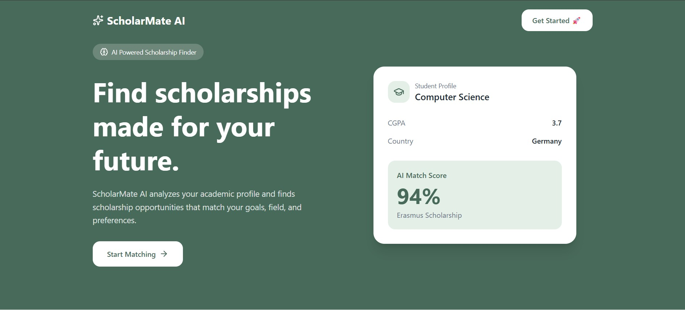
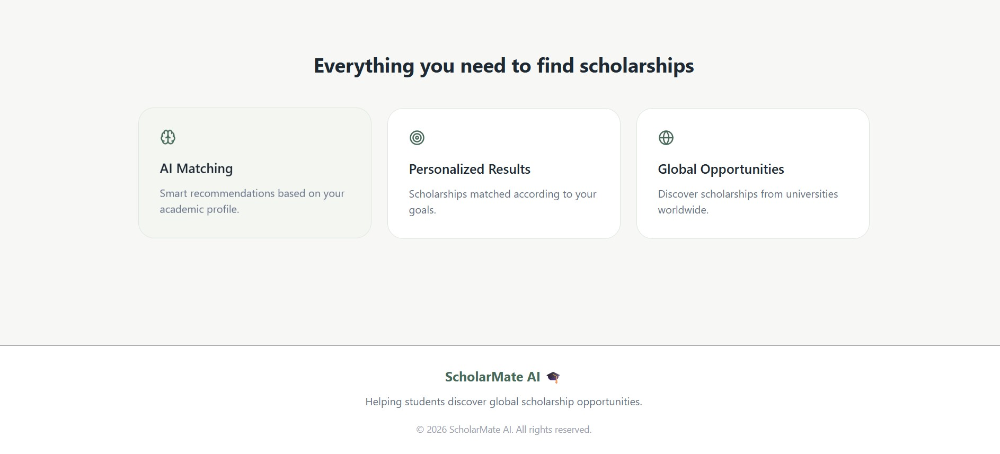

# 🎓 ScholarMate AI

ScholarMate AI helps students discover scholarships that fit their academic profile. It searches real web sources, extracts scholarship details with AI, checks those details against the source pages, and matches them to the student's degree level, nationality, grades, field and preferences.

ScholarMate AI is a research assistant, not an official database. Results are not exhaustive, and students should always confirm details on the official scholarship website before applying.

## ✨ Features

- 🔍 **Live scholarship search** across up to 6 targeted web searches per request (government programmes, universities, official portals, nationality-specific and funding-specific schemes)
- 🌍 **Destination coverage** for the USA, Canada, the UK, Germany, France, Italy, Austria, Switzerland, Denmark, Norway, Sweden, Finland and other European countries, Turkey, South Korea, Japan, China, Australia, New Zealand and more, or across all regions when no destination is chosen
- ✅ **Source verification**: scholarships the AI mentions but the source page does not name are removed, and deadlines, funding, requirements and links are only shown when a quote from the source supports them
- 🏛️ **Official vs third-party sources** are labelled clearly; third-party pages are never presented as official application pages
- 🗓️ **Application status** (open, opens soon, closing soon, closed, deadline not confirmed) from verified dates only
- 🎯 **Transparent matching**: "Meets verified requirements", "Preliminary match" or "Not eligible", with a per-requirement explanation (no fake percentage scores)
- 🔗 **Official website button** that only opens a verified official URL
- 📄 Country filter, pagination, honest coverage notes, and clear empty and error states
- 📱 Responsive design with Framer Motion animations and Tailwind CSS

## 🛠️ Tech Stack

- **Frontend:** React 19, Vite 8, Tailwind CSS 4, React Router 7, Framer Motion, Lucide icons
- **Backend:** Node.js, Express 5 (deployed as a Vercel Node.js function)
- **Providers:** [Tavily](https://tavily.com) web search, [Groq](https://groq.com) (`openai/gpt-oss-20b`) for extraction
- **Tests:** Node's built-in test runner (backend), Vitest + Testing Library (frontend)

## 🚀 Live Demo

[Live Demo](https://scholar-mate-ai-chi.vercel.app/)

## 🧭 How it works

1. The student fills in the profile (field, degree level, nationality, CGPA and scale, destination, funding preference).
2. The frontend sends the profile to `POST /api/search-scholarships`.
3. The backend plans up to 6 web searches for that profile and runs them on Tavily (basic depth, 3 at a time, 20-second budget).
4. Results are merged and de-duplicated. Pages are ranked by search relevance, how much they are about scholarships, and whether they are official; pages without scholarship content are skipped and at most 2 pages per website are kept.
5. Up to 8 pages (the most relevant 2,000 characters of each) are sent to Groq in one request (30-second budget). The AI must copy word-for-word quotes for every fact.
6. Every result is checked against its page: unnamed scholarships are dropped; dates, requirements, funding, places and links without supporting quotes are hidden or marked unconfirmed.
7. Each scholarship gets an application status and a match level from rule-based checks, duplicates across pages are merged, and results are ranked.
8. The response includes coverage information (sources searched and analyzed, notes about anything that failed or was skipped).

### Data rules

- **Grounding:** a scholarship is only kept if its name appears on the page it came from.
- **Dates:** only complete dates (day, month and year) that appear in a quoted sentence are used. Deadlines are treated as *Anywhere on Earth* (UTC-12): a deadline only counts as passed once that day has ended in every time zone. "Closing soon" means within 30 days.
- **Official sources:** government domains (`.gov`, `.gov.uk`, `.gc.ca`, `.go.kr`, `.go.jp`, `.gouv.fr`, `.govt.nz`, …), academic domains (`.edu`, `.ac.uk`, `.ac.jp`, `.edu.au`, …) and a reviewed list of official programme domains (DAAD, Chevening, Campus France, Study in Korea, Türkiye Burslari, …) count as official. Known aggregators and blogs are labelled third-party. Every other site is "Unverified source"; nothing is assumed official.
- **Application links** are only shown as official when they are on an official domain and either on a site that was actually retrieved or linked from the retrieved page.
- **Retrieval time** shows when the page was fetched. It is not proof that the information is still correct.
- **AI text** (summaries and the "AI's preliminary view") is labelled as AI-generated.

### Matching rules

- **Hard requirements** (decide eligibility): degree level, nationality, minimum grade, deadline.
- **Preferences** (affect ranking only): field of study, destination, funding level.
- **Meets verified requirements:** degree level and nationality are confirmed from source quotes and every other checked requirement is met.
- **Preliminary match:** no requirement is known to fail, but some could not be confirmed.
- **Not eligible:** a stated requirement is not met (including a passed deadline).
- Grades on different scales (for example 3.5/4 vs 8/10) are not converted, because conversions are not linear; the student is asked to confirm with the provider.

## 📦 Installation

```bash
git clone https://github.com/xuhaahmad/ScholarMate-AI.git
cd ScholarMate-AI
npm install
cp .env.example .env   # then add your own API keys to .env
npm run dev
```

Open http://localhost:5173. `npm run dev` starts the backend (port 5000) and the frontend together; Vite forwards `/api` requests to the backend.

### Try it without API keys

```bash
npm run dev:mock
```

This runs the real app against local mock search and AI providers (`scripts/mock-providers.js`). Every result is fake test data marked **[MOCK]**. Mock providers are only reachable on `localhost` and are ignored on Vercel.

### Scripts

| Command | What it does |
| --- | --- |
| `npm run dev` | Backend + frontend for local development |
| `npm run dev:mock` | Same, with local mock providers (no keys, no credits) |
| `npm run dev:client` / `npm run dev:server` | Frontend or backend only |
| `npm test` | All backend and frontend tests (no network calls, no credits) |
| `npm run test:backend` / `npm run test:frontend` | One test suite |
| `npm run lint` | ESLint |
| `npm run build` | Production build of the frontend |

## ⚙️ Configuration

Environment variables (names only; never commit real values):

| Variable | Required | Purpose |
| --- | --- | --- |
| `TAVILY_API_KEY` | Yes | Tavily web search |
| `GROQ_API_KEY` | Yes | Groq AI extraction |
| `API_PORT` | No | Local backend port (default 5000) |
| `ALLOWED_ORIGINS` | No | Comma-separated origins allowed to call the API from another website. Leave empty: the frontend uses the same origin. |
| `TAVILY_RAW_CONTENT` | No | Set to `false` to use only Tavily's short snippets instead of page text |

Optional limits (defaults in brackets; values outside the allowed range are clamped, see `backend/config.js`):

| Variable | Default | Meaning |
| --- | --- | --- |
| `SEARCH_MAX_QUERIES` | 6 (max 6) | Web searches per student search |
| `SEARCH_RESULTS_PER_QUERY` | 8 | Results per web search |
| `SEARCH_CONCURRENCY` | 3 | Web searches running at once |
| `SEARCH_QUERY_TIMEOUT_MS` / `SEARCH_STAGE_BUDGET_MS` | 12000 / 20000 | Time limits for web search |
| `AI_MAX_SOURCES` / `AI_BATCH_SIZE` | 8 / 8 | Pages analyzed and pages per AI request |
| `AI_SOURCE_CHAR_LIMIT` / `AI_MAX_OUTPUT_TOKENS` | 2000 / 2500 | Text per page sent to the AI, and AI output limit |
| `AI_REQUEST_TIMEOUT_MS` / `AI_STAGE_BUDGET_MS` | 20000 / 30000 | Time limits for AI analysis |
| `CACHE_TTL_MS` / `CACHE_MAX_ENTRIES` | 6 hours / 100 | In-memory result cache |
| `RATE_LIMIT_MAX` / `RATE_LIMIT_WINDOW_MS` | 6 / 15 minutes | Searches per IP address |
| `SEARCH_MAX_PER_HOUR` | 60 | Searches that reach the providers, per server instance per hour |
| `AI_MODEL` | `openai/gpt-oss-20b` | Groq model; `openai/gpt-oss-120b` is also accepted (higher cost, not tested in this project) |
| `AI_REASONING_EFFORT` | `low` | `low`, `medium` or `high`; only `low` has been tested with real searches |

## 💰 API usage and cost

Per search that is not served from the cache:

- **Tavily:** up to 6 basic-depth searches = up to 6 credits. Tavily's free tier is 1,000 credits per month (about 160 searches); pay-as-you-go is $0.008 per credit (about $0.05 per search). Tavily's credit documentation lists cost by search depth only; actual credits are reported in the server log after each search.
- **Groq (`openai/gpt-oss-20b`, $0.075 per million input tokens, $0.30 per million output tokens):** one request of roughly 5k input and at most 2.5k output tokens, about $0.0012 per search at most. Groq also limits tokens per minute depending on your plan; the defaults keep one search within a small per-minute budget, and if the limit is reached the search returns the results it has and says so. Raise `AI_BATCH_SIZE`, `AI_SOURCE_CHAR_LIMIT` or `AI_MAX_OUTPUT_TOKENS` only if your Groq plan allows more tokens per minute.
- Identical searches within 6 hours are served from the cache, and web-search results are reused across similar profiles, on the same server instance.

Prices were checked in October 2026 and can change.

## 🔒 Security

- API keys are only read on the server from environment variables and are never sent to the browser or written to logs.
- Logs contain timings and counts only, never profiles, prompts or provider responses.
- Request bodies are limited to 10 KB of JSON; only known profile fields are accepted; the student's name is not sent to the AI provider.
- Provider calls have hard deadlines, are cancelled when the deadline passes, and are never retried automatically.
- Per-IP rate limiting uses the client IP that Vercel writes into `X-Forwarded-For`; locally the header is ignored.
- Rate limits, caches and the hourly search budget are kept in memory per server instance. On Vercel each instance counts separately, so these are not global limits. For hard cost protection, also use Vercel Firewall rate limiting and spending limits in the Tavily and Groq dashboards.
- CORS is off by default. CORS is not authentication: the API remains publicly callable within the rate limits.

## ☁️ Deployment (Vercel)

`vercel.json` builds the frontend with `@vercel/static-build` and deploys `backend/server.js` as a Node.js function that handles `/api/*`. `backend/server.js` exports the Express app and does not start a server; `backend/local-server.js` is only used locally.

Before deploying:

1. Set `TAVILY_API_KEY` and `GROQ_API_KEY` for the Production (and Preview) environments in the Vercel project settings.
2. Turn on "Enable access to System Environment Variables" (Settings → Environment Variables) so `VERCEL=1` is available at runtime (needed for per-client rate limiting).
3. Test on a protected Preview deployment first: profile → search → results → details → official link.

**Rollback:** in the Vercel dashboard open *Deployments*, choose the previous production deployment and select *Promote to Production* (or *Instant Rollback*). In Git, revert the merge commit on `main`.

## ⚠️ Known limitations

- Search coverage depends on what Tavily returns; results are never exhaustive.
- With the default model, real test searches returned 1–4 scholarships per search even when the analyzed pages named more. The AI is conservative and its output varies between runs; only scholarships it extracts and that pass the source checks are shown.
- Groq occasionally rejects an answer as invalid JSON (HTTP 400); the app uses the attempted answer when it can be parsed and otherwise shows an error with a Retry button.
- The AI may miss scholarships on long pages, because only the most relevant part of each page (2,000 characters by default) is analyzed.
- On smaller Groq plans, searches made less than a minute apart can hit Groq's per-minute token limit; the app then shows a "busy" message or partial results.
- Many university websites outside the recognised domain patterns are shown as "Unverified source" even when they are official.
- Nationality rules that refer to groups (for example "developing countries" or "Commonwealth countries") cannot be checked automatically and are left as "not confirmed".
- Rate limits, caches and budgets are per server instance (see Security).

## 📸 Screenshots

### Home Page



### Profile Page


## 📂 Project Structure

```
backend/
 ├── server.js            Vercel entry point (exports the Express app)
 ├── local-server.js      Local development server
 ├── app.js               Routes, validation, caching, rate limiting, errors
 ├── scholarshipSearch.js Search → extraction → verification → matching pipeline
 ├── searchPlan.js        Builds the targeted web searches
 ├── sources.js           URL safety and official/third-party classification
 ├── dates.js             Date verification and application status
 ├── matching.js          Eligibility checks and ranking
 ├── countries.js         Countries, nationalities and destinations
 ├── config.js            Search budget and limits
 ├── cache.js, rateLimit.js, validation.js
 └── *.test.js            Backend tests
src/
 ├── pages/               Home, Profile, Loading, Results, ScholarshipDetails, About
 ├── components/          Navbar, Footer, InputField, ScholarshipCard
 ├── utils/               Display, filtering and pagination helpers
 └── test/                Frontend test setup and fixtures
scripts/                  Development runner and local mock providers
```

## 👨‍💻 Author

**Zuha Ahmad**

BS Computer Science  
COMSATS University Islamabad

---

Made with ❤️ using React and Tailwind CSS.
